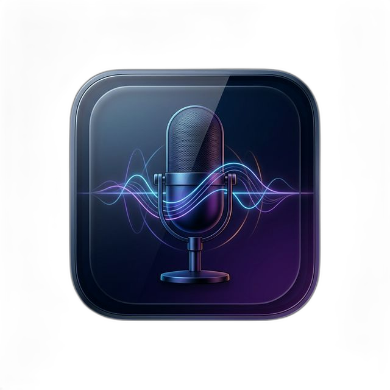

<p align="center">
  
</p>

<h1 align="center">NoType</h1>

<p align="center">
  No Type, Just Talk, Happy Coding!<br>
  按下快捷键，说话，文字回到你正在输入的地方。
</p>

<p align="center">
  <a href="https://github.com/yahuo/NoType/releases/latest"></a>
  <a href="./LICENSE"></a>
  <a href="https://github.com/yahuo/NoType/actions/workflows/ci.yml"></a>
  <a href="https://github.com/yahuo/NoType/actions/workflows/linux.yml"></a>
  
</p>

NoType 是一个开源的桌面语音输入与翻译工具。写代码、回消息、填表单时，按一下快捷键开始说话，结束后文字直接粘贴回当前输入框，不用切到另一个转写工具，也不用手动复制粘贴。

它以 macOS 菜单栏应用为主，同时提供 Linux（Omarchy）版本、Chrome / Edge 网页双语翻译扩展，以及 Pi、Claude Code、Codex CLI 等终端 Agent 的草稿翻译集成。

## 功能

### macOS 应用

| 快捷键 | 作用 |
| --- | --- |
| `Option + Space` | 开始 / 结束语音输入，结果粘贴回当前输入框 |
| `Option + Shift + Space` | 有选中文本时翻译成英文并替换；没有选中时说话，插入英文 |
| `Option + Control + Space` | 选中文字翻译成中文，在浮窗中阅读，不修改原文 |
| `Option + Esc` | 取消录音、转写、改写或翻译 |

- **两种转写引擎**：Codex 复用本机登录态，录音结束后整段识别；Doubao 流式识别实时显示文字，可选 `AI Rewrite` 把口语稿整理成适合发送或交给 AI 执行的文字。
- **Neo 语音助手**：自定义唤醒词，支持连续对话、插话打断和语音结束会话；通过本机 Codex 联网搜索、读取屏幕和操作应用。
- **稳定的文本注入**：统一走剪贴板 + `Cmd + V`；在中文、日文、韩文输入法下临时切到 ASCII，完成后恢复输入法和原剪贴板；没有可编辑焦点时把结果留在剪贴板。
- **菜单栏常驻**：带 `Setup`、`Settings` 和底部悬浮 HUD，录音时显示波形或实时文字。

### Linux（Omarchy）

Rust 守护进程以 systemd 用户服务运行，配合 Hyprland 快捷键和 Omarchy 桌面壳插件，提供与 macOS 版相同的听写、英文翻译、选词中文翻译和桥接能力；可选 fcitx5 addon 支持在任意输入框三连空格翻译。见 [integrations/omarchy/README.md](./integrations/omarchy/README.md)。

### 浏览器双语翻译

Chrome / Edge 扩展，点击工具栏按钮后在原文下方流式显示中文译文，支持 iframe。YouTube 视频页显示原文 + 中文双语字幕，可在设置页隐藏原文、调整字号。macOS 和 Linux 通用，见 [integrations/browser/README.md](./integrations/browser/README.md)。

### 终端 Agent 草稿翻译

通过本地 Unix socket bridge，把 Pi、Claude Code、Codex CLI 输入框里的中文草稿翻译成英文并替换，不依赖终端的辅助功能输入框。Pi 和 Claude Code 支持三连空格触发。见 [docs/bridge.md](./docs/bridge.md)。

## 安装

### macOS（Apple Silicon，macOS 14+）

Homebrew：

```bash
brew install --cask ssdev-labs/tap/notype
```

后续使用 `brew upgrade --cask notype` 升级。已经手动安装相同版本时，可用 `brew install --cask --adopt ssdev-labs/tap/notype` 纳入 Homebrew 管理。

也可以从 [Releases](https://github.com/yahuo/NoType/releases/latest) 下载 DMG 或 ZIP，把 `NoType.app` 放进 `/Applications`。

当前下载包使用 Apple Development 签名，未经过 Apple 公证；首次打开若被拦截，请在「系统设置 → 隐私与安全性」中允许 NoType。

首次启动后打开 `Setup` 授权：

- 麦克风：语音输入
- 辅助功能：读取选区和粘贴文本
- 语音识别：Neo 离线唤醒

Codex 听写、AI Rewrite、翻译和 Neo 需要本机已完成 `codex login`；Neo 还需要安装 Codex 桌面应用。Doubao 模式需要自行配置凭证。

### Linux（Omarchy）

```bash
git clone https://github.com/yahuo/NoType.git
cd NoType
integrations/omarchy/install.sh --browser --pi
```

安装脚本会编译 Rust 守护进程、安装 systemd 用户服务、Hyprland 快捷键和桌面壳插件。不想本地编译时，可把 Release 附件中的 x86_64 二进制放到 `linux/target/release/notype`，再加 `--no-build` 运行。依赖和配置见 [integrations/omarchy/README.md](./integrations/omarchy/README.md)。

### 浏览器扩展

扩展需要配合本地连接程序使用，安装步骤见 [integrations/browser/README.md](./integrations/browser/README.md)。

## 从源码构建（macOS）

直接运行：

```bash
swift run NoType
```

构建并安装到 `/Applications`：

```bash
make install
```

只产出签名后的 `dist/NoType.app`：

```bash
make build
```

构建脚本以 `release` 模式编译，生成图标并组装 `.app`。签名优先使用本机的 `Developer ID Application`，其次 `Apple Development`，都没有时使用 ad-hoc 签名；也可用 `NOTYPE_CODESIGN_IDENTITY` 指定。

在 Xcode 中开发：

```bash
ruby scripts/generate_xcodeproj.rb
open NoType.xcodeproj
```

选择 `NoType` target，在 `Signing & Capabilities` 中启用 `Automatically manage signing` 并选择开发团队，然后 Run 或 Archive。

## 配置 Doubao ASR

在应用的 `Settings` 中填写：

- `App ID`
- `Resource ID`
- `Access Token`

当前界面里给出了 1.0 和 2.0 资源示例：

- 1.0 小时版：`volc.bigasr.sauc.duration`
- 1.0 并发版：`volc.bigasr.sauc.concurrent`
- 2.0 小时版：`volc.seedasr.sauc.duration`
- 2.0 并发版：`volc.seedasr.sauc.concurrent`

存储方式：

- `Access Token` 存在 macOS Keychain
- 其他设置存到本地 `UserDefaults`

## 配置 Codex 语音转写

在 `Settings -> Speech -> Speech Provider` 选择 `Codex` 并保存。首次使用默认 Codex；已有设置继续保留 Doubao，需要手动切换。

- 复用本机 Codex 登录态，不需要 OpenAI API Key，也不需要豆包凭证。
- `Check Codex Login` 只检查本地登录，不会上传录音；真实转写须使用听写快捷键验证。
- 录音结束后，将完整的 16 kHz 单声道录音发送到 `https://chatgpt.com/backend-api/transcribe`，统一识别并返回结果。
- 上传前优先使用系统编码器压缩为 FLAC，保持原始采样数据不变；编码失败或文件未变小时使用 WAV。
- 返回文本直接插入，不调用 AI Rewrite，不把“换行”等普通词语额外替换为控制命令。
- 语音翻译仍会在转写后调用英文翻译；选词翻译、网页翻译和 TUI 翻译沿用原流程。
- 取消会终止上传并丢弃旧结果；完成、失败或取消后清理本次临时录音。

这是内部接口，模型和文字整理效果由服务端决定。真人测试中观察到部分语气词被过滤，合成语音也有保留口头词和改口的情况；NoType 本身不额外改写 Codex 转写文本。

协议参考：[codex-voice 的 Swift 实现](https://github.com/anthnykr/codex-voice/blob/main/CodexVoice/CodexTranscriptionService.swift)、[codex-stt-bridge 的兼容记录](https://github.com/ai-babai/codex-stt-bridge/blob/main/docs/API-COMPATIBILITY.md)、[haskell-agent 的内部流式协议](https://github.com/digitallyinduced/haskell-agent/blob/master/packages/agent-openai/src/Agent/OpenAI/Transcription.hs)。

`swift test` 默认不调用真实服务。使用非敏感的 16 kHz、单声道、16-bit 小端原始 PCM 文件，可单独验证实际 Swift 转写链路（会上传录音并打印结果）：

```bash
NOTYPE_CODEX_SMOKE_PCM=/absolute/path/sample.pcm swift test --filter codexTranscriptionLiveSmoke
NOTYPE_CODEX_SMOKE_PCM=/absolute/path/sample.pcm swift test --filter codexTranscriptionCompressionLiveComparison
```

流式转写客户端仅保留在测试目录，不编入应用。真人使用反馈识别质量下降后，应用已恢复整段识别；如需对照，可对同一段录音单独运行 `codexDictationStreamLiveSmoke`。接口可用、耗时降低或合成录音测试成功，均不能证明真人识别质量与原接口相当。

接口实测和本地测试不等同于全局快捷键、麦克风及目标应用粘贴验收；切换到测试版后仍需实际听写确认。

诊断日志只记录状态码、经过校验的请求标识、音频字节数及准备/上传/等待耗时，不记录凭据、录音或转写正文。403 表示本次请求被拒绝，不直接判定账号永久不可用，也不会盲目自动重试。查看最近的记录：

```bash
/usr/bin/log show --last 30m --style compact --predicate 'subsystem == "com.opensource.notype" AND category == "CodexDictation"'
```

## 配置 AI Rewrite

在 `Settings -> AI Rewrite` 中可以配置：

- `Enable AI Rewrite`

以下开关只作用于 Doubao 模式；Codex 模式始终直接输入：

- `AI Rewrite Off`：直接插入 Doubao ASR 的最终结果
- `AI Rewrite On` 且本机存在 Codex 登录态：先调用 Codex 改写，再插入最终文本
- `AI Rewrite On` 但未登录 Codex：不阻塞主链，继续使用原始转写

听写改写最多等待 30 秒收到首段文字；开始输出后，连续 15 秒没有新增文字才判定停滞，总时限为 2 分钟。正常流式输出会延长等待，不再在第 10 秒硬性中断。超时或其他改写失败时，仍使用原始转写结果插入；可随时按 `Option + Esc` 取消。

NoType 只读取本机 Codex access token，不刷新 refresh token；Codex 语音转写、`AI Rewrite` 和翻译都会复用这份 Codex 登录态。如果登录态过期，请打开 Codex 刷新登录，或重新 `codex login`。

`AI Rewrite` 的目标不是重度润色，而是把口语稿整理成更适合发送和更适合 AI 执行的文本：

- 去掉 filler words、即时重复和改口
- 保留约束、限制条件、交付项和技术术语
- 对任务、需求、验收要求优先整理成更利于 AI 执行的结构
- 普通聊天则保持自然段，不强行列表化

## 使用流程

1. 打开菜单栏应用，完成麦克风和辅助功能授权。
2. 在 `Settings` 中选择 Codex 或 Doubao；Codex 使用本机登录态，Doubao 填写对应凭证。
3. Doubao 模式如需 `AI Rewrite`，先在终端完成 `codex login`，再打开 `Enable AI Rewrite`。
4. Codex 自动识别语言，Doubao 可选择识别语言。
5. 在任意输入框聚焦后，按 `Option + Space` 开始录音。
6. 再按一次 `Option + Space` 结束录音，或按 `Option + Esc` 取消。
7. Codex 返回最终转写后直接插入；Doubao 返回最终转写后：
   - 若 `AI Rewrite` 关闭，直接进入插入
   - 若 `AI Rewrite` 开启且 Codex 登录态可用，HUD 会先显示 `Rewriting…`，等 Codex 返回后再插入
8. 如果检测到可编辑焦点，文本会通过剪贴板 + `Cmd + V` 注入当前输入框。
9. 如果没有可编辑焦点，结果会保留在剪贴板里，供你手动粘贴到任意位置。

英文翻译流程：

1. 选中一段文本后按 `Option + Shift + Space`，NoType 会读取选中文本，调用 Codex 翻译成英文，再替换当前选区。
2. 没有选中文本时按 `Option + Shift + Space`，NoType 会开始录音；再次按 `Option + Space` 结束后，先完成 ASR，再把转写结果翻译成英文并插入。

选词中文翻译流程：

1. 在网页、文档或输入框中选中一段文字，按 `Option + Control + Space`。
2. NoType 优先通过辅助功能读取选区，读取不到时尝试模拟复制并恢复原剪贴板；未读到文字时在浮窗提示，不会开始录音。
3. 独立浮窗流式显示简体中文译文，可滚动阅读、展开原文，完成后点击“复制译文”才会把译文写入剪贴板。不会替换或粘贴到原应用。
4. 点击“关闭”或按 `Option + Esc` 关闭浮窗并取消当前翻译。

此功能只需要辅助功能权限与现有 Codex 登录态，不需要配置麦克风或 Doubao；录音或其他 AI 处理进行中时不响应此快捷键。

中文浮窗翻译使用独立的 3 分钟总时限，网络连续 60 秒无响应时会超时；等待期间可随时关闭取消。

## 验证

```bash
swift test
make build
```

如果要生成发布产物：

```bash
make package
```

如果你后面加入了付费 Apple Developer Program，并且已经配置好 `Developer ID` 和 `notarytool` keychain profile，可以直接跑完整 notarization 流程：

```bash
NOTYPE_NOTARY_PROFILE=AC_NOTARY make notarize
```

当前默认的实验性分发说明见 [docs/release.md](./docs/release.md)。本地 Agent TUI 通信协议与 Pi 安装方式见 [docs/bridge.md](./docs/bridge.md)。官网静态站位于 [site/README.md](./site/README.md)。

## 项目结构

```text
Sources/NoType/App         应用状态、生命周期和主流程
Sources/NoType/Models      配置、状态和数据模型
Sources/NoType/Services    音频采集、热键、ASR、AI Rewrite、Neo、权限、文本插入等服务
Sources/NoType/Views       菜单栏、设置、HUD、引导界面
Sources/NoType/Support     PCM 与转写文本处理辅助工具
Sources/NoTypeEditor       Claude/Codex external-editor 代理
Sources/NoTypeEditorCore   external-editor draft 解析逻辑
Tests/NoTypeTests          测试
linux/                     Linux 版 Rust 守护进程
scripts/                   构建、打包、图标、Xcode 工程生成脚本
packaging/                 App bundle 资源与图标
site/                      官网静态站
integrations/browser       Chrome / Edge 网页双语翻译扩展与本地连接程序
integrations/omarchy       Omarchy 安装脚本、systemd 服务、Hyprland 快捷键和桌面壳插件
integrations/fcitx5        fcitx5 三连空格翻译 addon
integrations/pi            Pi TUI 的 NoType bridge 扩展
integrations/claude-code   Claude Code 输入框内三连空格翻译的 mod
integrations/agent-editor  Claude Code / Codex CLI 的 external-editor 安装脚本
```

## Roadmap

- [x] 菜单栏主流程、快捷键、录音、转写、文本插入
- [x] Codex 整段转写与 Doubao 流式转写，可选 AI Rewrite
- [x] 语音英文翻译、选中文本英文翻译和选词中文翻译
- [x] Neo 语音助手
- [x] Pi、Claude Code、Codex CLI 的本地 draft 翻译 bridge
- [x] Chrome / Edge 网页双语翻译与 YouTube 双语字幕
- [x] Linux（Omarchy）版本
- [ ] Developer ID 签名与 notarization
- [ ] 自动更新
- [ ] 更稳定的跨应用文本插入兼容性
- [ ] 更清晰的产品级 onboarding 和错误提示

## 参与共建

欢迎提 issue、提 PR，或者直接 fork 成更适合你自己的版本。

比较值得先看的目录是 `Sources/NoType/App`、`Sources/NoType/Services`、`Sources/NoType/Views`、`linux/src` 和 `integrations/`。提交信息遵循 [Conventional Commits](https://www.conventionalcommits.org/)。

## 当前边界

- macOS 发布包只提供 Apple Silicon（arm64），未经过 Apple notarization。
- Linux 版本面向 Omarchy（Arch Linux + Hyprland + quickshell），其他发行版和桌面环境未验证。
- 裸 `Fn/Globe` 会和 macOS Emoji/输入法入口冲突，因此默认使用 `Option + Space` 和 `Option + Shift + Space`。
- 文本插入统一依赖 Accessibility + 模拟粘贴，不再走 AX 直写优先。
- Codex 转写、`AI Rewrite`、翻译和 Neo 依赖本机 Codex 登录态和 Codex 后端可用性；Codex 语音使用内部接口，可用性取决于服务端。
- Agent TUI bridge 当前只支持本机进程；远程 SSH 会话需要额外转发 socket。
- Doubao 协议兼容性以当前仓库实现为准，升级资源协议时需要重新核对字段和握手行为。

## 许可证

[MIT](./LICENSE) © 2026 yahuo
